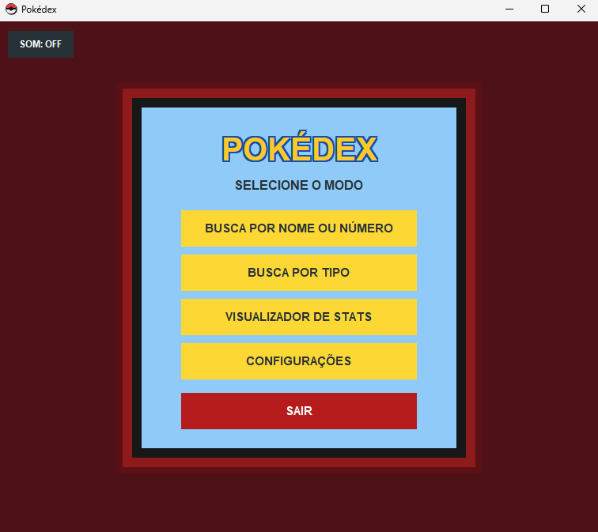
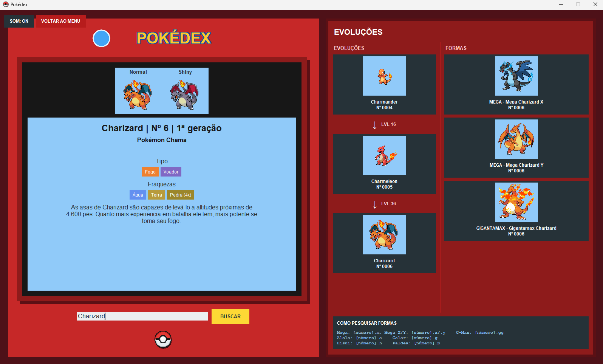
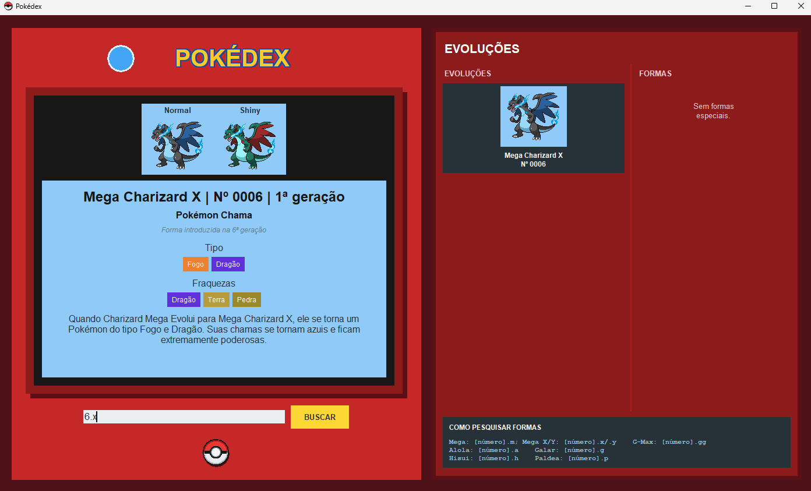
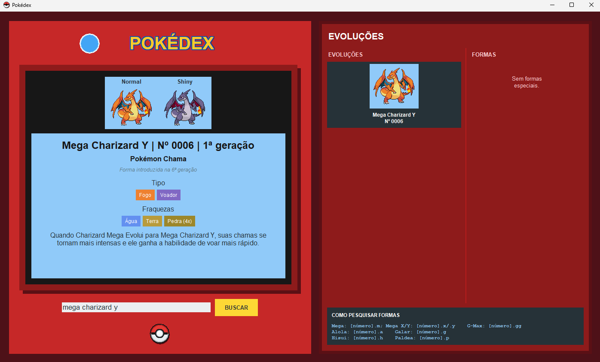

# 🗺️ Pokédex (Kanto - Pokémon 1 a 151)

[](https://github.com/Balvesz/Minha-Pokedex.git)


Este é um projeto pessoal focado no meu aprendizado de programação. É uma Pokédex interativa desenvolvida em Python que lista e exibe detalhes dos primeiros 151 Pokémon da franquia (Geração 1), incluindo o suporte para a visualização de suas formas alternativas.

O projeto foi estruturado de forma modular para separar a lógica da interface, os dados dos Pokémon e a execução principal.

---

## 🛠️ Estrutura do Projeto

* **`files/main.py`**: O arquivo principal que inicia e gerencia o fluxo da aplicação.
* **`files/HUD.py`**: Módulo responsável pela renderização da interface e elementos visuais na tela.
* **`files/database_pokemons.py`**: Banco de dados em código contendo as informações, atributos e caminhos dos 151 Pokémon e suas formas.
* **`imagens/`**: Pasta contendo os sprites e recursos visuais utilizados no projeto.

## 🚀 Processo de Desenvolvimento & Tecnologias

O projeto foi desenvolvido combinando lógica de programação tradicional com ferramentas modernas de Inteligência Artificial:

* **Python 3.13** - Linguagem base utilizada para a construção de todo o ecossistema.
* **Banco de Dados Estruturado (`database_pokemons.py`)** - Desenvolvido 100% por mim para mapear os 151 Pokémon originais, suas tipagens, fraquezas, cadeias evolutivas e caminhos de arquivos de forma local e offline.
* **Tkinter (HUD)** - Interface gráfica construída em colaboração com o **GitHub Copilot**. Atuei no direcionamento estético, refinamento de layout, regras de negócios e na integração total da interface com os dados dos Pokémon.
* **Módulos nativos (`os`, `re`, `urllib`)** - Utilizados para a engenharia de busca flexível (por nome, número ou sintaxes como `6.x`) e manipulação interna de diretórios.

## 📌 Funcionalidades Atualizadas

* **Catálogo Completo de Kanto**: Exibição dos Pokémon do número **1 ao 151**.
* **Formas Alternativas**: Suporte integrado para alternar e visualizar variações (como versões Shiny, Mega, Gigantamax e formas regionais alternativas).
* **Organização Modular**: Código dividido em arquivos separados para facilitar a manutenção.

## 📸 Demonstração Visual

<table>
  <tr>
    <td><strong>Sistema de busca por nome</strong><br></td>
    <td><strong>Sistema de busca por número</strong><br></td>
  </tr>
  <tr>
    <td><strong>Sistema de busca de forma alternativa por número</strong><br></td>
    <td><strong>Sistema de busca de forma alternativa por nome</strong><br></td>
  </tr>
</table>

## 🎮 Como Executar o Projeto

1. Certifique-se de ter o **Python** instalado na sua máquina.

2. Clone este repositório no seu computador:
   ```bash
   git clone https://github.com/Balvesz/Minha-Pokedex.git
   ```
3. Navegue até o diretório do projeto:
   ```bash
   cd Minha-Pokedex
   ```
4. Execute o arquivo principal que está localizado dentro da pasta `files`:
   ```bash
   python files/main.py
   ```